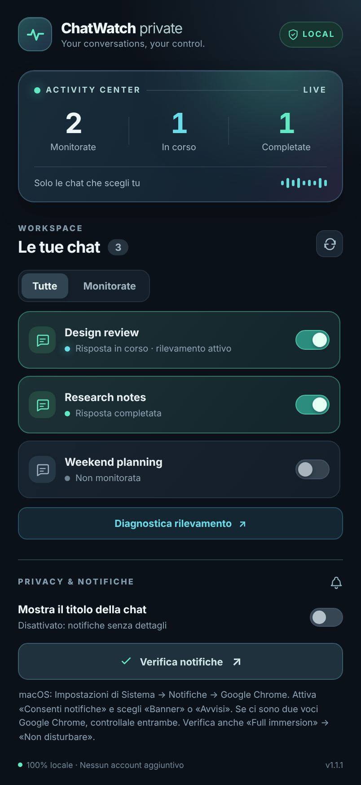

<div align="center">

# ChatWatch Private

**Know when a ChatGPT reply is ready — without monitoring every conversation.**

A lightweight, local-first Chrome extension that lets you select which open ChatGPT conversations to watch and sends a desktop notification when a response finishes.

**Windows · macOS · Linux · Chrome Manifest V3**

</div>



> [!NOTE]
> This is an independent, unofficial project. It is not affiliated with or endorsed by OpenAI. The preview uses fictional conversation titles.

## Features

- **Opt-in per conversation:** monitoring is off by default. Turn it on only for the chats you choose.
- **Live activity overview:** see the number of monitored, running, and completed conversations in open ChatGPT tabs.
- **Response completion notifications:** receive a Chrome desktop notification when a monitored response appears to finish.
- **Return to your conversation:** click a completion notification to focus its existing Chrome tab.
- **Privacy by default:** notification titles hide chat names unless you explicitly enable them.
- **Cross-platform help:** notification troubleshooting automatically adapts to macOS, Windows, Linux, and ChromeOS using Chrome's `runtime.getPlatformInfo()` API.
- **Detection diagnostics:** inspect signals such as submit events, Stop-button detection, assistant activity, and completion counts without collecting message text.
- **No backend or telemetry:** no account, server, third-party library, or tracking service required.

## Requirements

- Google Chrome **116 or newer** on a desktop operating system.
- A ChatGPT conversation open in Chrome at `chatgpt.com` (legacy `chat.openai.com` URLs are also included).
- Notifications permitted for Google Chrome in your operating system.
- The current popup interface is in Italian; the README and contributor documentation are in English.

## Install without the Chrome Web Store

You **do not** need a Chrome Web Store developer account or a paid publishing registration to use this extension locally.

1. Download the repository using **Code → Download ZIP**, then extract it, or clone it with Git.
2. Keep the extracted or cloned `ChatWatch-Private` directory in a permanent location.
3. Open Chrome and navigate to **`chrome://extensions`**.
4. Enable **Developer mode**.
5. Click **Load unpacked** and select the directory containing `manifest.json`.
6. Optionally pin ChatWatch to the Chrome toolbar using the extensions menu.
7. Open or reload your ChatGPT tabs and click the ChatWatch icon.
8. Enable monitoring for your chosen conversations; click **Verifica notifiche** to test notifications.

> [!IMPORTANT]
> Do not delete or move the loaded extension directory after installing it. Chrome reads the extension files from that local path. A GitHub repository is a source-code host, not an automatic extension updater.

## How to use

1. Open one or more ChatGPT tabs in Chrome.
2. Click the extension icon to open the dashboard.
3. Switch monitoring on for the conversations you want to track. **Off** means ChatWatch does not watch that conversation.
4. The dashboard shows when a watched response is in progress and when it appears to have completed.
5. Click the desktop notification to return to the relevant tab, provided it is still open.
6. If needed, open **Diagnostica rilevamento** while a reply is being generated to inspect the detection signals.

**Conversation identity:** for existing chats with a `/c/…` URL, the enabled state is saved locally by conversation ID, including across reopened tabs. A new chat without a saved ID is tracked temporarily within its tab; once ChatGPT assigns an ID, the setting is transferred to that conversation. Opening a different existing chat does not automatically enable it.

**Notification title:** by default, the notification does not include the conversation title. The optional *Mostra il titolo della chat* setting reveals it on desktop notifications. Chat titles are displayed in the local popup so you can choose the correct tab.

## Desktop notifications and OS-specific troubleshooting

The popup detects the operating system and displays its appropriate settings path after **Verifica notifiche**. The API can confirm that Chrome accepted a notification; it **cannot guarantee** that an operating-system banner was actually displayed.

| System | Where to allow Google Chrome notifications |
| --- | --- |
| **macOS** | Apple menu → **System Settings → Notifications → Google Chrome** → **Allow Notifications**; choose *Banners* or *Alerts*. If there are multiple Chrome entries, check each one. Check **Focus → Do Not Disturb**. |
| **Windows 11** | **Settings → System → Notifications → Google Chrome**; enable notifications and banners. Check **Do not disturb**. |
| **Windows 10** | **Settings → System → Notifications & actions**; allow notifications for Google Chrome. Check **Focus assist** if present. |
| **Linux** | Desktop settings → **Notifications**; allow Chrome notifications and check Do Not Disturb. Paths vary across GNOME/KDE and distributions. |
| **ChromeOS** | **Settings → Apps → Notifications**; check Chrome notifications and Do Not Disturb. |

If the extension does not react to a ChatGPT tab, reload that tab (`⌘R` on Mac, `Ctrl+R` on Windows/Linux) and verify that the extension is enabled in `chrome://extensions`.

The Chrome page `chrome://settings/content/notifications` controls **website** notification permissions. ChatWatch uses the **extension** notifications API, so website permission alone is not the same as the operating-system permission for Chrome.

## Privacy and permissions

| Permission / access | Purpose |
| --- | --- |
| `storage` | Saves selected conversation IDs and settings locally. New unsaved conversations use session storage. |
| `notifications` | Creates desktop notifications. |
| `https://chatgpt.com/*`, `https://chat.openai.com/*` | Allows the content script to observe response-state UI elements only on ChatGPT domains. |

- **No message body collection:** the detector inspects UI controls and state changes rather than sending or storing conversation text.
- **DOM access:** like any authorized content script, the extension technically has access to the page's DOM, which may contain chat text. Review the source before installing.
- **No remote communication in the extension code:** no `fetch`, remote analytics, third-party fonts, or hosted backend.
- **No cookies, browsing history, clipboard, or OpenAI API access** requested.
- Selected conversation IDs and preferences remain in the local Chrome profile. Remove the extension (including its stored data) if you want to reset it completely.

## Technical overview

```text
ChatGPT page
    |
    v
content.js  -- UI state and response detection
    |
    v
background.js  -- saved settings, tab routing, notifications
    |
    v
Chrome desktop notifications

popup.html + popup.js  -- selected conversations and diagnostics
platform.js             -- OS-aware notification settings help
```

The detector uses `MutationObserver` for relevant UI changes, coalesces scans, and uses a short interval only while a response is in progress. A locally maintained state machine avoids notifying on every DOM mutation; clicking **Stop** manually should not trigger a completion notification.

### Files

```text
ChatWatch-Private/
├── .github/workflows/tests.yml
├── docs/screenshots/popup.png
├── icons/
├── tests/
├── background.js
├── content.js
├── manifest.json
├── platform.js
├── popup.css
├── popup.html
├── popup.js
├── CHANGELOG.md
├── CONTRIBUTING.md
├── LICENSE
├── README.md
├── SECURITY.md
└── package.json
```

## Development and tests

The extension uses **vanilla JavaScript** and has no runtime dependencies. The test runner requires Node.js 18+.

```bash
npm test
```

The tests check notification behavior, selected conversations, detector state transitions, popup element references, and OS-specific help. GitHub Actions runs the same tests on pushes and pull requests.

### Updating your unpacked installation

1. Update the files in the **same directory** Chrome loaded (e.g. `git pull`).
2. Open **`chrome://extensions`** and click **Reload** on ChatWatch Private.
3. Reload open ChatGPT tabs to refresh their content scripts.

Using the **same directory** helps Chrome retain the installed extension's identity and its saved settings. Loading a second copy from another path can create a separate installation with separate data.

## Limitations

- ChatWatch relies on ChatGPT's page markup, **not on a stable public completion-status API**. UI updates can break detection or cause false positives/negatives.
- Completion detection is best-effort; some activity transitions and network errors can resemble completion.
- Chrome may suspend inactive tabs through Memory Saver, delaying detection.
- The extension only monitors Chrome tabs in the local browser profile where it is installed; it cannot see conversations on other devices or in desktop/mobile apps.
- Automated tests are not equivalent to full end-to-end validation with a live signed-in ChatGPT session.
- Notifications are subject to Chrome and OS settings, including Focus / Do Not Disturb.

## Contributing

Bug reports and pull requests are welcome. See [CONTRIBUTING.md](CONTRIBUTING.md) for testing and change guidelines. Please **do not attach real conversation contents, cookies, tokens, or other sensitive data** to issues.

## License

Released under the [MIT License](LICENSE).
